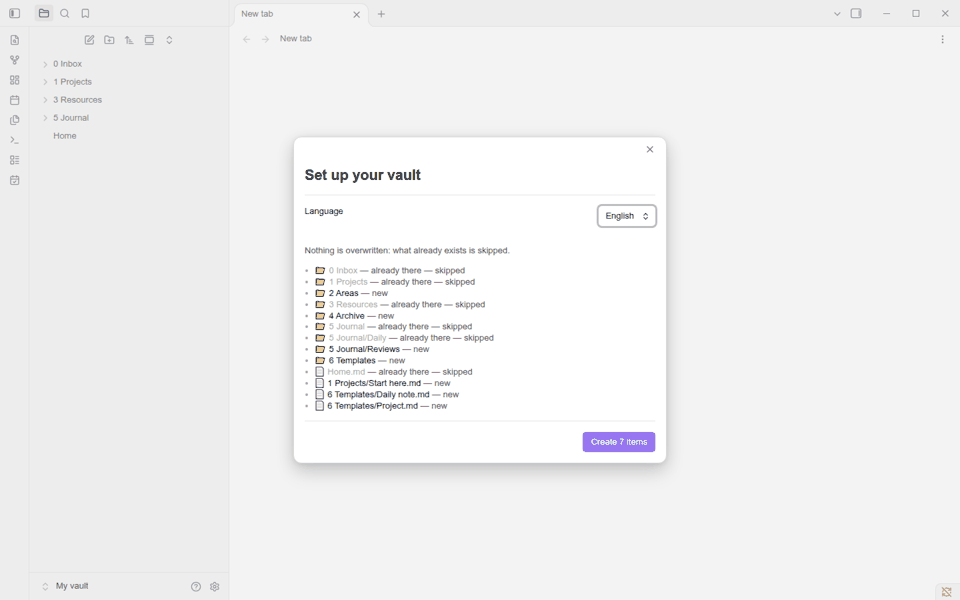
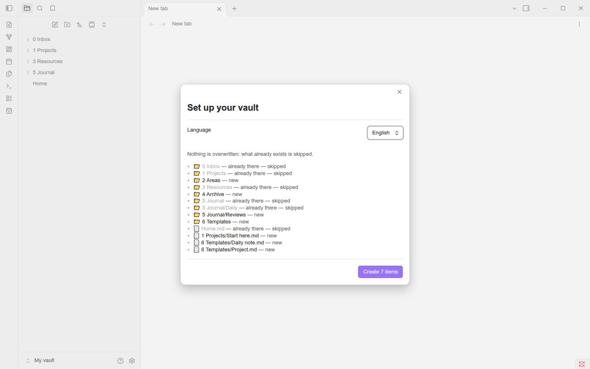
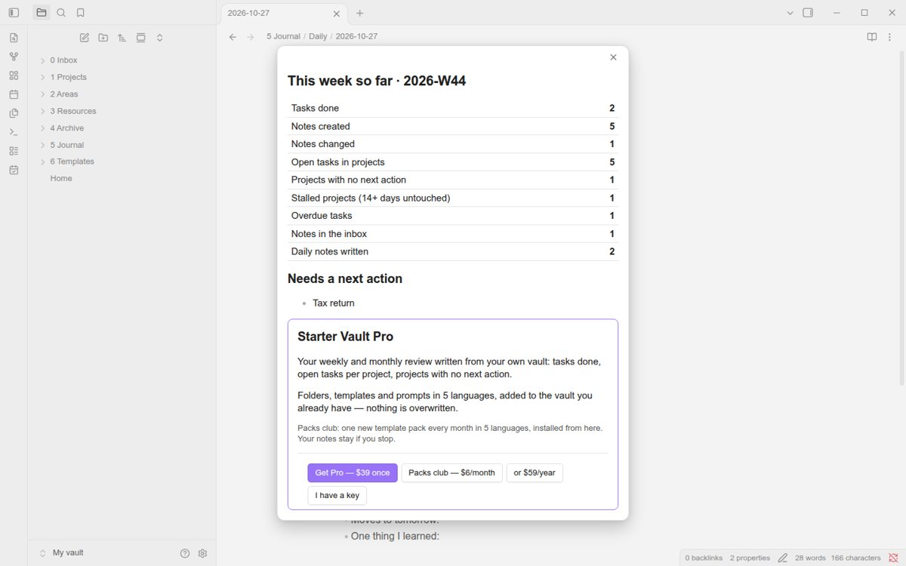
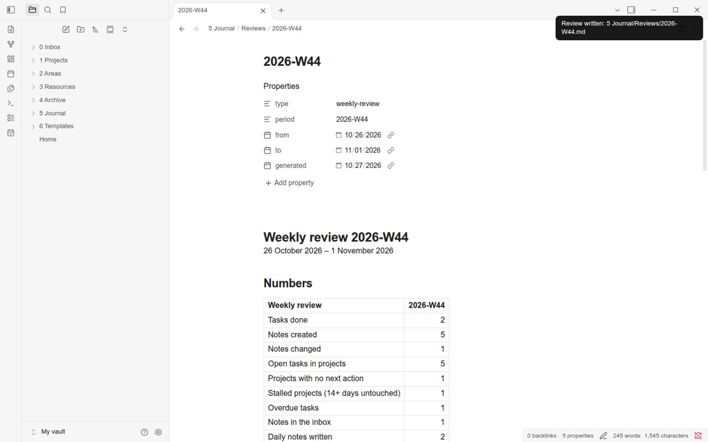

# Starter Vault

Set up PARA folders, a Home note, a daily note and project notes **in the vault you already have** — in English, Deutsch, Español, Português or 日本語. Nothing is overwritten: setup lists every folder and note first and skips what already exists.



*Recorded by this repo's end-to-end test in the real Obsidian 1.14.5 app, on a vault that already had notes.*

## What it does (free)

| Command | What happens |
|---|---|
| **Set up my vault** | Shows the list first — `0 Inbox · 1 Projects · 2 Areas · 3 Resources · 4 Archive · 5 Journal/Daily · 5 Journal/Reviews · 6 Templates`, a Home note, a "Start here" project, the daily-note and project templates — and marks what is already there as skipped. One click creates the rest. |
| **Open today's daily note** | `5 Journal/Daily/YYYY-MM-DD.md` with *Top 3 today · Tasks · Notes · End of day* (calendar icon in the ribbon). |
| **New project** | A project note with *Outcome · Next actions · Notes · Log*. |
| **Preview this week** | This week's numbers from your notes: tasks done, notes created and changed, open tasks in projects, projects with no next action, stalled projects (14+ days untouched), overdue tasks, notes in the inbox, daily notes written. |

Folder names, headings, prompts and dates are in your language; pick it in setup or in the settings.




## Pro and Packs club (paid)

**Payment is required for full access to the features in this section.** Pro is a one-time purchase; the Packs club is a monthly or yearly subscription. Both are sold at https://getreadystack.com/apps/obsidian-starter-vault-plugin/ and unlock with a licence key (Settings → Starter Vault → Enter licence key).

- **Write this week's / month's / quarter's review** — a note in `5 Journal/Reviews/` with the numbers above, what you finished, open tasks per project, projects that need a next action, stalled and overdue items, then your reflection prompts. Run it again and the part you wrote below "Your review" is kept.
- **Roll-over** — when today's daily note is created, yesterday's open tasks move to *Tasks*; the old lines become `- [>]`.
- **Move finished projects to the archive** — projects with `status: done` (or erledigt, terminado, concluído, 完了 …) move to `4 Archive/<year>/`; Obsidian updates the links.
- **10 more templates** in 5 languages: weekly, monthly, quarterly and yearly review, meeting, person, book, area, decision, goal.
- **Packs club:** a new template pack every month in 5 languages, installed from *Template packs* (the 2026-11 pack: year in review 2026, plan 2027, December close-out). Files you installed stay in your vault if you stop.



## Network use

The plugin works offline. It connects to **getreadystack.com** only for:

1. **Licence check** — when you enter a key, and again at most once every 7 days: `GET https://getreadystack.com/api/lic?key=<your key>&slug=<product>`. Only the key is sent.
2. **Template packs** — when you open *Template packs*: the public list `https://getreadystack.com/apps/obsidian-starter-vault-plugin/packs-index.json`, and, when you install a pack, `https://getreadystack.com/api/dl/<product>?key=<your key>`.

No note content, file names or usage data leave your vault. No telemetry, no ads. The plugin never installs or updates code; packs are Markdown templates.

## How tasks are counted

A `- [x]` task is counted as done in a period if it has a `✅ YYYY-MM-DD` date in that period (the Tasks plugin format), if it is in a daily note dated in that period, or — for ticks without a date — on the day this plugin first saw it ticked (kept in the plugin's own data file; ticks that existed before you installed it have no day and are not counted).

## Install

- **Community plugins:** search for "Starter Vault" (once listed).
- **BRAT:** *Add beta plugin* → `jmshinhwa/readystack-starter-vault`.
- **Manual:** copy `main.js`, `manifest.json`, `styles.css` from the [latest release](https://github.com/jmshinhwa/readystack-starter-vault/releases/latest) to `<vault>/.obsidian/plugins/starter-vault/` and enable it.

Works on desktop and mobile with Obsidian 1.4.0 or newer; no other plugin needed.

## Develop

```
npm install
npm run build        # main.js (+ the same engine for the web page)
npm test             # 13 unit tests on a fixture vault with hand-counted numbers
```

`test/` in the product folder also runs an end-to-end test in the real Obsidian app (Xvfb + Playwright over CDP).

## License

MIT — © 2026 ReadyStack. Starter Vault is independent and not affiliated with or endorsed by Obsidian.
